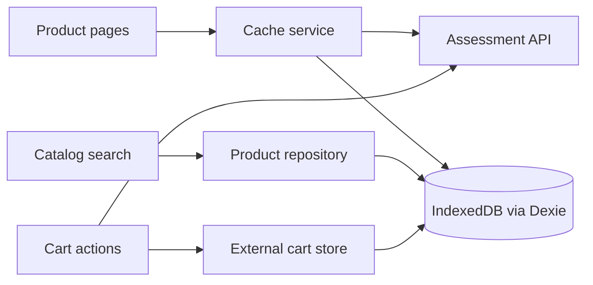

# Mobile Storefront

> A frontend technical assessment for Nunegal Consulting.

[](https://github.com/MaxiPS/mobile-storefront-challenge/actions/workflows/ci.yaml)

Mobile Storefront is a responsive React single-page application for browsing mobile devices, viewing technical details, and adding selected variants to a cart. Product data is cached in the browser, and catalog searches run against local IndexedDB data.

## Features

- Browse a responsive product catalog with up to four columns on wide screens.
- Search products by brand or model using local IndexedDB data.
- View product specifications and choose color and storage options.
- Add a selected variant to the cart and share the updated count across routes.
- Show loading, error, empty, no-results, and stale-cache states.

## Technology

| Area | Technology |
| --- | --- |
| Application | React, Vite, and JavaScript |
| Routing | React Router |
| UI components | shadcn/ui and Radix UI |
| Application styling | CSS |
| Local persistence | Dexie.js over IndexedDB |
| Shared state | `useSyncExternalStore` |
| Tests | Vitest and React Testing Library |
| Code quality | ESLint |

Tailwind CSS is retained for the shadcn/ui setup; the application's own layout and styles are written in CSS.

## Getting started

### Requirements

- Node.js 20.19 or later, or 22.12 or later (the CI workflow uses Node.js 24).
- npm.

### Install and run

```bash
npm ci
npm run START
```

Vite prints the local development URL in the terminal.

## Available scripts

| Command | Purpose |
| --- | --- |
| `npm run START` | Start the Vite development server. |
| `npm run BUILD` | Create a production build. |
| `npm run TEST` | Run the test suite once. |
| `npm run TEST:WATCH` | Run tests in watch mode. |
| `npm run LINT` | Check JavaScript and JSX with ESLint. |

## Routes

| Path | View |
| --- | --- |
| `/` | Product listing and local search. |
| `/products/:id` | Product details and cart actions. |
| Any other path | Not-found page. |

## Architecture and data flow



### Catalog and local search

The API service encapsulates HTTP requests. The storage service caches product list and detail responses in Dexie for one hour and stores normalized search fields in the `products` table. When the list cache is missing or expired, the app requests fresh data and updates IndexedDB. If refresh fails after expiration, the saved response remains available and the page marks it as stale.

The search field calls the local product repository, which filters the IndexedDB records by brand and model. Changing the search term does not call the API.

### Cart state

The cart API receives `{ id, colorCode, storageCode }`. Its returned `count` updates an external store and is persisted in IndexedDB. React components subscribe to stable store snapshots through `useSyncExternalStore`.

### UI and styling

The application uses editable shadcn/ui components with CSS for its own layout, responsive breakpoints, and visual tokens. Pages compose the UI, API, storage, and store modules; they do not access `fetch` or Dexie directly.

## API and fixtures

The application uses the assessment service at `https://itx-frontend-test.onrender.com/api`:

| Method | Endpoint | Purpose |
| --- | --- | --- |
| `GET` | `/product` | Load the product catalog. |
| `GET` | `/product/:id` | Load product details and variant options. |
| `POST` | `/cart` | Add a product variant and receive the cart count. |

Representative GET responses are stored in `tests/fixtures/`. Automated tests mock `fetch` and use fixtures, so the test suite and CI do not depend on the live API. The API's detail response uses the field names `dimentions` and `secondaryCmera`.

## Testing and quality

Functional work follows Red–Green–Refactor. Tests cover API behavior with mocked responses, local persistence with fake IndexedDB, and observable UI behavior with React Testing Library. The CI workflow runs tests, a production build, and ESLint on pull requests targeting `main`.

Run the same checks locally:

```bash
npm run TEST
npm run BUILD
npm run LINT
```

## Known limitations

- Uncached catalog and detail requests, product images, and cart updates depend on the assessment service being available.
- IndexedDB is local to the browser and site origin. Clearing browser site data removes the local cache and saved cart count.
- If an API refresh fails, the app can show saved catalog or detail data as stale; it cannot refresh while the service is unavailable.
- Automated tests mock the cart endpoint. The live cart endpoint has not been manually called because it changes remote cart data.

## Project conventions

Source code, comments, and commit messages are written in English. Keep application behavior in focused modules and cover each new behavior with tests before implementation.
