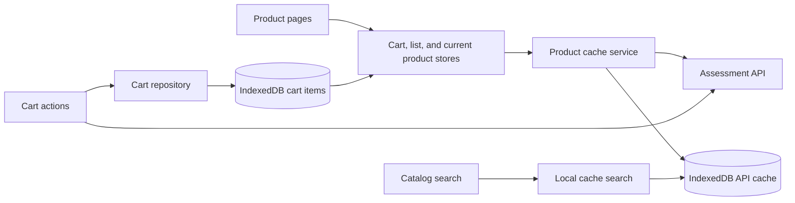

# Mobile Storefront

> A frontend technical assessment for Nunegal Consulting.

[](https://github.com/MaxiPS/mobile-storefront-challenge/actions/workflows/ci.yaml)

Mobile Storefront is a responsive React single-page application for browsing mobile devices, viewing technical details, and adding selected variants to a cart. Product data is cached in the browser, and catalog searches run against local IndexedDB data.

## Features

- Browse a responsive, virtualized product catalog with infinite scrolling.
- Search products by brand or model using local IndexedDB data.
- View product specifications and choose color swatches and storage options.
- Persist cart selections locally and restore the count after a reload.
- Navigate with breadcrumbs, keyboard controls, and visible focus indicators.
- Show loading, error, empty, no-results, and stale-cache states.

## Technology

| Area | Technology |
| --- | --- |
| Application | React, Vite, and JavaScript |
| Routing | React Router |
| UI components | shadcn/ui and Radix UI |
| Application styling | CSS |
| Product cache | Dexie.js over IndexedDB |
| Browser testing | Playwright (Chromium) |
| Shared state | Three in-memory stores with `useSyncExternalStore` |
| Tests | Vitest, React Testing Library, MSW, and Playwright |
| Coverage | Vitest V8 provider |
| Code quality | ESLint |

Tailwind CSS is retained for the shadcn/ui setup; the application's own layout and styles are written in CSS.

## Getting started

### Requirements

- Node.js 24.x (pinned by `.nvmrc` and used in CI). Node 22.12+ within the 22.x line is also supported by the current test toolchain.
- npm.

### Install and run

```bash
npm ci
npm run START
```

Vite prints the local development URL in the terminal.

## Available scripts

| Command | Purpose |
| --- | --- |
| `npm run START` | Start the Vite development server. |
| `npm run BUILD` | Create a production build. |
| `npm run TEST` | Run the test suite once. |
| `npm run TEST:WATCH` | Run tests in watch mode. |
| `npm run COVERAGE` | Run Vitest and generate text, HTML, and LCOV coverage reports. |
| `npm run E2E` | Run Chromium end-to-end tests. |
| `npm run LINT` | Check JavaScript and JSX with ESLint. |

## Routes

| Path | View |
| --- | --- |
| `/` | Product listing, local search, and the `Products` breadcrumb. |
| `/products/:id` | Product details and cart actions. |
| Any other path | Not-found page. |

Product details include a `Products` breadcrumb link back to the listing. Route changes move keyboard focus to the new page's main landmark.

## Architecture and data flow



### Catalog and local search

The API service encapsulates HTTP requests. Dexie keeps product list and detail responses in the single `apiCache` table for one hour. When the cache is missing or expired, the app requests fresh data and updates IndexedDB when storage is available. If an API refresh fails, a valid saved response can be shown as stale; a `404` invalidates the cached product so deleted items are not shown again.

The list store calls the local product repository, which reads the cached list from IndexedDB and filters it by brand and model. Changing the search term does not call the API.

### Cart state

The cart API receives `{ id, colorCode, storageCode }`. After a successful response, the selected variant and returned count are written to Dexie's `cartItems` table. The shared cart store restores its count from those records on load, so it survives a page reload. Product list and current product state remain in separate in-memory stores; React subscribes to all three through `useSyncExternalStore`.

### UI and styling

The application uses editable shadcn/ui components with CSS for its own layout, responsive breakpoints, keyboard focus indicators, and visual tokens. Pages compose the UI, API, storage, and store modules; they do not access `fetch` or Dexie directly.

The storefront's visual refinement follows the supplied product design while preserving the assessment's SPA behavior. The Impeccable design workflow guided a focused review of hierarchy, spacing, product imagery, responsive catalog cards, and product variant controls. Impeccable is a design aid and is not a runtime dependency.

## API and fixtures

The application uses the assessment service at `https://itx-frontend-test.onrender.com/api`:

| Method | Endpoint | Purpose |
| --- | --- | --- |
| `GET` | `/product` | Load the product catalog. |
| `GET` | `/product/:id` | Load product details and variant options. |
| `POST` | `/cart` | Add a product variant and receive the cart count. |

Representative GET responses are stored in `tests/fixtures/`. API contract and page integration tests use MSW to intercept requests at the expected endpoints. Playwright also mocks the API, so local and CI E2E runs do not depend on the live service. The API's detail response uses the field names `dimentions` and `secondaryCmera`.

## Testing and quality

Functional work follows Red-Green-Refactor. Vitest and React Testing Library cover API behavior, IndexedDB persistence, invalid responses, cache failures, and race conditions. Playwright covers keyboard shopping, route focus, cart restoration after reload, responsive grid layouts, and product virtualization during real browser scrolling. The CI workflow runs tests with coverage, a production build, ESLint, and Chromium E2E on pull requests targeting `main`.

Run the same checks locally:

```bash
npm run TEST
npm run COVERAGE
npm run E2E
npm run BUILD
npm run LINT
```

## Known limitations

- Uncached catalog and detail requests, product images, and cart updates depend on the assessment service being available.
- The assessment API does not enable credentialed CORS for the app's origin. The browser therefore cannot reuse the API's session cookie as Postman does; the app persists selected cart items locally and uses the API count when it is greater than the local item count.
- IndexedDB is local to the browser and site origin. Clearing browser site data removes the product cache.
- If an API refresh fails, the app can show saved catalog or detail data as stale; it cannot refresh while the service is unavailable.
- Automated tests mock the cart endpoint to avoid relying on or changing remote cart data.

## Project conventions

Source code, comments, and commit messages are written in English. Keep application behavior in focused modules and cover each new behavior with tests before implementation.
